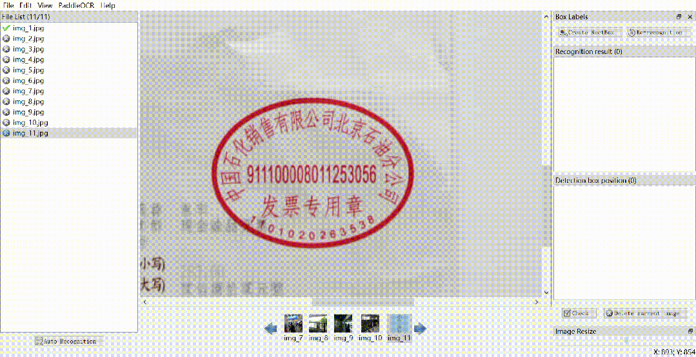

# [paddleocr] PPOCRLabel Annotation Tool Usage

PPOCRLabelv2PPOCRLabel is a semi-automatic graphical labeling tool for the OCR field, with built-in PP-OCR models.

## PPOCRLabelv2

PPOCRLabel is a semi-automatic graphical labeling tool for the OCR field, which includes an embedded PP-OCR model for automatic data labeling and re-identification. It is written in Python3 and PyQT5, supporting rectangular box labeling, table labeling, irregular text labeling, key information labeling modes, and export formats can be directly used for training of PaddleOCR detection and recognition models.

| Regular Annotation || Table Annotation |

|
 ||
 |
| Irregular Text Annotation || Key Information Annotation |



 ||
 |

# Recent updates

-

2022.05: Added table annotation, see the usage below `2.2 Table Annotation` (by whjdark; Evezerest)

-

2022.02: Added key information annotation, optimized annotation experience (by PeterH0323)

-

Added: Use `--kie` to enter KIE functionality for the tag of "Detection + Recognition + Keyword Extraction".

-

Enhance User Experience: Added file and mark count prompts, optimized interaction, and fixed issues with GPU usage.

-

New feature: Rotate the bounding box using `C` and `X`.

-

2021.11.17: 

-

New support for installing and starting PPOCRLabel via the whl package (by d2623587501)

-

Dataset splitting: Training, validation, and test set division of the labeled data (Refer to Section 3.5 below by MrCuiHao).

-

2021.8.11: 

-

New feature: Open the data folder, and right-click to rotate images 90 degrees (Note: Before rotating, there should not be any annotation boxes on the image. By Wei-JL)

-

Added shortcut key explanations (Help - Shortcuts) and fixed the directional shortcut move functionality under batch processing (by d2623587501).

-

2021.2.5: Added batch processing and undo features (by Evezerest)

-

Batch processing feature: Holding the Ctrl key, you can perform batch operations such as moving, copying, deleting, and re-recognition after selecting the marked boxes.

-

Undo function: After drawing a four-point annotation box or editing the box, pressing Ctrl+Z will undo the previous operation.

-

Fix image rotation and size issues, optimize the process of editing rectangular boxes (by ninetailskim, edencfc)

-

2021.1.11: Optimizing Annotation Experience (by Edencfc)

-

Users can select whether to display the input box after drawing the detection box by selecting "View - Pop-up Marker Input Box".

-

The recognition results are synchronized with the detection box scrolling.

-

The recognition result is changed to click to modify. (If it cannot be modified, please switch to the system's built-in input method, or switch back to the original input method)

-

2020.12.18: Support for re-recognition of individual bounding boxes (by ninetailskim), and enhancement of shortcut keys.

If you have different ideas about improving the tool, please register for the community competition to make changes and earn points for rewards.

### 1. Installation and Operation

1.1 Install PaddlePaddle

```
pip3 install --upgrade pip
# If your machine is a CPU, run the following command to install.
python3 -m pip install paddlepaddle -i https://pypi.tuna.tsinghua.edu.cn/simple
```

For more version requirements, please refer to the instructions in the installation documentation.

1.2 Installation and Operation of PPOCRLabel

PPOCRLabel can be started in two ways: via the whl package and via a Python script. The whl package-based startup is more convenient, while the Python script-based startup facilitates secondary development.

1.2.1 Installation and Running via whl package

###### Windows

```
pip install PPOCRLabel # Installation
# Choose the tag mode to start
PPOCRLabel --lang ch # Start in "Normal Mode," for labeling scenes involving detection and recognition.
PPOCRLabel --lang ch --kie True # Start the KIE mode, used for labeling scenes involving detection, recognition, and keyword extraction.
```

>

Note: The PPOCRLabel package is automatically downloaded through the whl package when installed via the whl package. The shapely dependency may encounter the error "[winRrror 126] Cannot find the specified module". It is recommended to download and install it from here.

###### Ubuntu Linux

```
pip3 install PPOCRLabel
pip3 install trash-cli
# Choose the tag mode to start
PPOCRLabel --lang ch # Start in "Normal Mode," for labeling scenes involving detection and recognition.
PPOCRLabel --lang ch --kie True # Start the KIE mode, used for labeling scenes involving detection, recognition, and keyword extraction.
```

###### MacOS

```
pip3 install PPOCRLabel
pip3 install opencv-contrib-python-headless==4.2.0.32 # If downloading is slow, add "-i https://mirror.baidu.com/pypi/simple"
# Choose the tag mode to start
PPOCRLabel --lang ch # Start in "Normal Mode," for labeling scenes involving detection and recognition.
PPOCRLabel --lang ch --kie True # Start the KIE mode, used for labeling scenes involving detection, recognition, and keyword extraction.
```

>

If the aforementioned installation encounters issues, refer to Section 3.6 Error Messages for guidance.

##### 1.2.2 Run PPOCRLabel via Python script

If you make changes to the PPOCRLabel file (e.g., specify a new built-in model), it will be more convenient to see the results of the changes through a Python script. If you still need to start with the whl package, you need to first uninstall the whl package in the current environment, and then refer to the next section to recompile the whl package.

```
cd ./PPOCRLabel # Switch to the PPOCRLabel directory
python PPOCRLabel.py --lang ch
```

##### 1.2.3 Build the local whl package and install it

```
cd ./PPOCRLabel
pip install -e .
```

##### 1.2.4 Pyinstaller packaging and running

```
cd ./PPOCRLabel
# Install pyinstaller
pip install pyinstaller
# Regenerate resources
pyrcc5 -o libs/resources.py resources.qrc
# Packing executable programs
pyinstaller -c PPOCRLabel.py --collect-all paddleocr --collect-all pyclipper --collect-all imghdr --collect-all skimage --collect-all imgaug --collect-all scipy.io --collect-all lmdb --collect-all paddle --hidden-import=pyqt5  -p ./libs -p ./ -p ./data -p ./resources -F
# Run the executable program in dist, for example on Windows.
PPOCRLabel.exe --lang ch
```

### 2. Use

2.1 Operation steps

>

If you only need to label text information and locations, it is recommended to follow the following steps:

1.

Installation and Operation: Use the above command to install and run the program.

1.

Open Folder: Click "File" in the menu bar, then "Open Directory" to select the folder containing the images you want to mark [1].

1.

Automatic Annotation: Click "Automatic Annotation" to automatically label images whose filenames before the image status [2] are "X" using the PP-OCR ultra-light model.

1.

Manual annotation: Click "Rectangle Annotation" (recommended to click "W" in English mode on the keyboard), users can manually draw rectangular boxes for areas not detected by the model. Pressing the keyboard Q will switch to a four-point annotation mode (or click "Edit" - "Four-point Annotation"), where users need to click on four points successively, and then double-click with the left button to indicate that the annotation is complete.

1.

After the markup box is drawn, when the user clicks "Confirm", the detection box will be pre-assigned a "pending recognition" label first.

1.

Re-identification: After all detection boxes in the image have been drawn/adjusted, click "Re-Identification". The PP-OCR model will re-identify all detection boxes in the current image.

1.

Content change: Click on the recognition result to manually correct any inaccurate recognition results.

1.

Confirmation Mark: Click "Confirm" to switch the image status to "√", and then go to the next one.

1.

Delete: Click "Delete Image" and the image will be deleted to the recycle bin.

1.

Export Result: The user can manually export the results by selecting "File - Export Marker Results" from the menu, and also can click "File - Automatically Export Marker Results" to start automatic export. The marked labels that have been manually confirmed will be stored in *Label.txt* under the opened image folder. After clicking "File" - "Export Recognition Results" in the menu bar, the recognition training data for such images will be saved in *crop_img* folder, and the recognition labels will be saved in *rec_gt.txt* [4].

2.2 Table Annotations (Video Demonstration)

The table annotation involves the structured extraction of tables from images, converting them into Excel format. Therefore, annotation must be completed in conjunction with external software that opens Excel simultaneously. In the PPOCRLabel software, text information within the table (text and position) is labeled. In the Excel file, structural information of the table is also labeled. The recommended steps are as follows:

1.

Table Recognition: After opening a table image, click the "Table Recognition" button in the top right corner of the software. The software invokes the table recognition model from PP-Structure to automatically label the table and simultaneously opens Excel.

1.

Change Annotation Results: Add annotation boxes (i.e., all text within a cell is marked as one box) based on the cells in the table. Right-clicking on an annotation box and selecting "Recognize Cell" allows the model to automatically recognize the text within the cell.

>

Note: If there are blank cells in the table, they should also be marked with a rectangle to ensure that the total number of cells matches the image.

1.

Adjust Cell Ordering: Click on the "View - Display Frame Numbers" to open the frame number display, and drag all results under the "Recognition Results" column in the right side of the software interface. This will arrange the frame numbers from left to right and top to bottom, with each row labeled accordingly.

1.

Labeling table structure: In an external Excel software, mark the cells containing text with any arbitrary identifier (e.g., `1`), ensuring that the cell merges in Excel are consistent with the original image (i.e., there is no need for exact matching between the text in the Excel cells and the text in the image).

1.

Export JSON format: Close all the Excel tables corresponding to the images, click "File" - "Export Table Markup", and generate an gt.txt markup file.

2.3 Notes

[1] PPOCRLabel uses folders as the basic markup unit. After opening the image folder to be labeled, it will not display images in the window bar but directly imports the images under the folder into the program after clicking "Select Folder".

[2] The image status indicates whether the user has manually saved this image. If it has not been manually saved, it is represented as "X", and if it has been manually saved, it is represented as "√". After clicking the "Auto-Labeling" button, PPOCRLabel will not re-label images with a status of "√".

[3] After clicking "Re-identify", the model will overwrite the recognition results in the image. Therefore, if manual changes have been made to the recognition results before this, there may be changes after re-identification.

[4] The files generated by PPOCRLabel are placed under the "marked image" folder. Please do not manually change the content of these files, as doing so may cause the program to malfunction.

| File Name || Description |

| Label.txt || This file contains the detection labels, which can be directly used for training the PPOCR detection model. The program will automatically write to this file after each user confirms five detection results. It will also be written when the user closes the application or switches file paths.
| fileState.txt || This file stores the names of images that have been manually confirmed by the user in the current folder.
| Cache.cach || This is a cache file that saves the results of the model's automatic recognition.
| rec_gt.txt || This file contains the recognition labels. It can be directly used for training the PPOCR recognition model. It is generated by clicking the "File" menu item in the menu bar and selecting "Export Recognition Results."
| crop_img || This is the recognition data, which is an image cut according to the detection box. It is produced simultaneously with rec_gt.txt.

### 3. Explanation

3.1 Shortcuts

| Shortcuts || Description |

| Ctrl + shift + R || Re-identify all marks on the current image |
W || New Rectangle Box
| Q || Create a new multi-point box |
| X || Rotate the box counterclockwise |
C || Frame clockwise rotation
Ctrl + E || Edit the selected box label |
Ctrl + X || In `--kie` mode, modify the keyword types of Boxes
| Ctrl + R || Re-identify the selected tags |
Ctrl + C || Copy and paste the selected box |
Ctrl + Left Mouse Click || Multi-select Markup Box
Backspace | Delete the selected box |
| Ctrl + V || Confirm this image mark |
| Ctrl + Shift + d || Delete this image |
| D || Next image |
A || The previous image |
| Ctrl++ || Resize |
| Ctrl-- || Zoom In |
| ↑→↓← || Move the marker box |

3.2 Built-in models

-

Default Model: PPOCRLabel Defaultly uses the Chinese and English ultra-light OCR model from PaddleOCR, supporting recognition of both Chinese and English texts as well as numbers, with support for multiple languages.

-

Model language switching: Users can switch the built-in model language through the "PaddleOCR" - "Select Model" menu item. Currently, supported languages include French, German, Korean, and Japanese. For specific model download links, refer to the PaddleOCR model list.

-

Custom Model: If the user wants to replace the built-in model with their own inference model, they can use the custom model code. By modifying the instantiation of PaddleOCR class in PPOCRLabel.py or PPStructure, for example, specifying the detection model: `self.ocr = PaddleOCR(det=True, cls=True, use_gpu=gpu, lang=lang)` and passing their own model into det_model_dir, it can be done.

#### 3.3 Export Marker Results

PPOCRLabel supports three export methods:

-

Automatic Export: After clicking "File - Automatically Export Marker Results", the program automatically writes the marker results into Label.txt whenever a user confirms an image. If this option is not enabled, the automatic export will occur after the user has manually confirmed 5 images.

>

The default is that the automatic export feature is in the off state.

-

Manual Export: Click "File - Export Marker Results" to manually export the markers.

-

Close application export

3.4 Dataset Splitting

Enter the following command in the terminal to execute the dataset partitioning script:

-
-

```
cd ./PPOCRLabel
```

‍

Parameters Description:

-

`trainValTestRatio` is the proportion of images in training set, validation set, and test set. It should be set according to actual circumstances, defaulting to `6:2:2`.

-

`datasetRootPath` is the full dataset path for PPOCRLabel annotations. The default path is `PaddleOCR/train_data`. Before splitting the dataset, it should have the following structure:

-
-
-
-
-
-
-
-
-
-
-
-

```
|-train_data  |-crop_img    |- word_001_crop_0.png    |- word_002_crop_0.jpg    |- word_003_crop_0.jpg    | ...  | Label.txt  | rec_gt.txt  |- word_001.png  |- word_002.jpg  |- word_003.jpg  | ...
```

#### 3.5 Error Notifications

-

If the WHL package is used to install paddleocr, its priority is greater than that of calling the PaddleOCR class through paddleocr.py. This can cause program exceptions when the WHL package is not updated.

-

PPOCRLabel does not support automatic annotation of images with Chinese filenames.

-

For Linux users: If you encounter an error starting with "objc[XXXXX]" during the software opening process, it indicates that your OpenCV version is too high. It is recommended to install version 4.2.

```
pip install opencv-python==4.2.0.32

```

-

If an error starting with `Missing string id` is encountered, compile the resources again.

```
pyrcc5 -o libs/resources.py resources.qrc

```

-

If the error "module 'cv2' has no attribute 'INTER_NEAREST'" occurs, firstly, all opencv related packages should be deleted, and then reinstall the 4.2.0.32 version of headless opencv.

```
pip install opencv-contrib-python-headless==4.2.0.32
```


## Payment

Here is a pay link on Stripe ( https://buy.stripe.com/3cs8yP7sY87d0vu9AB ). Please contact me lonlonago@foxmail.com after funding $89, and I will send you a complete data files , thank you!


